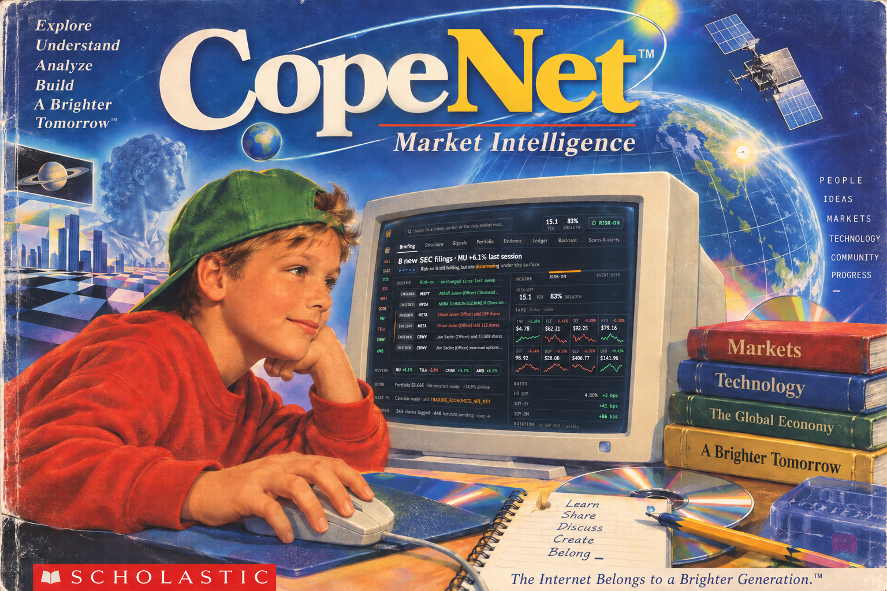
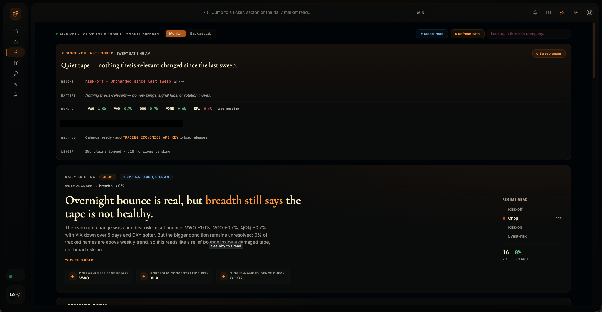
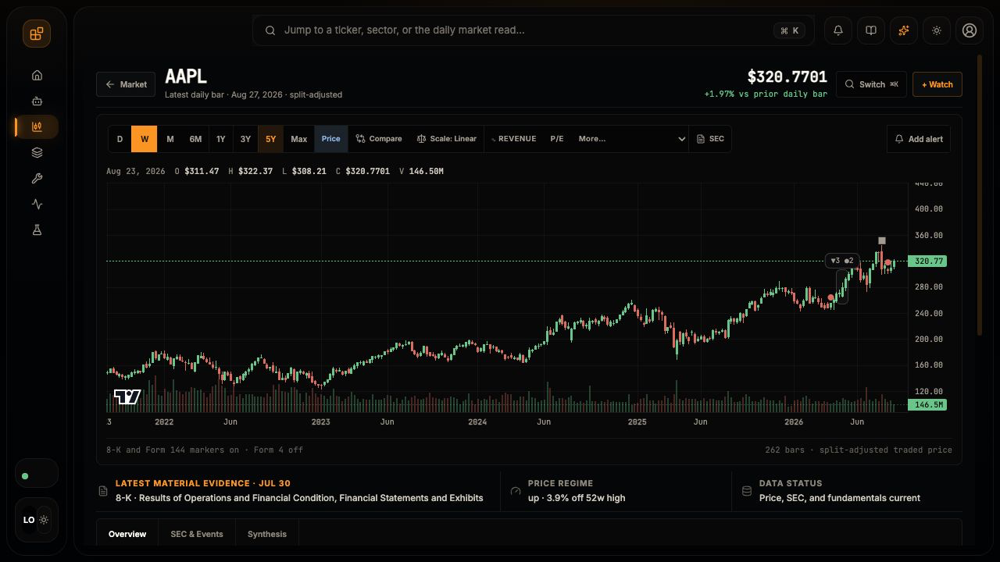
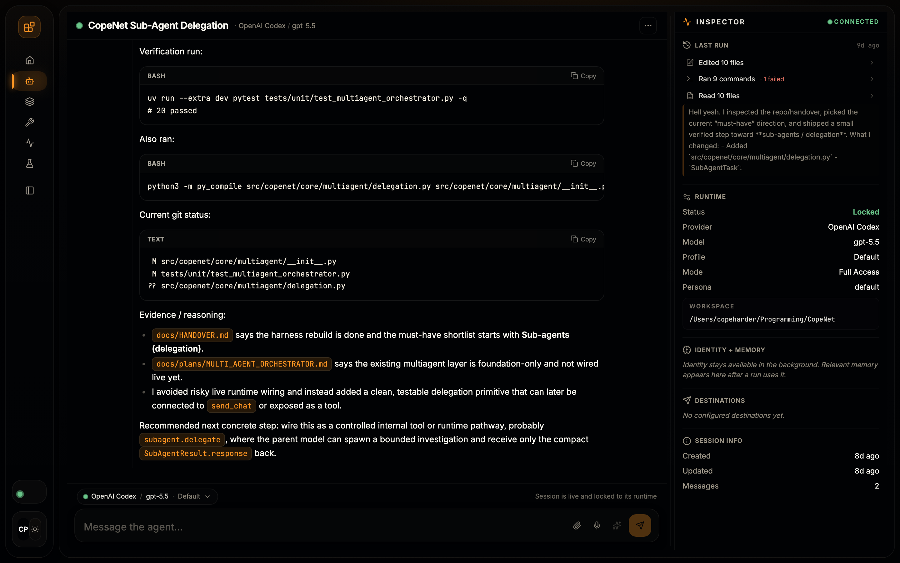
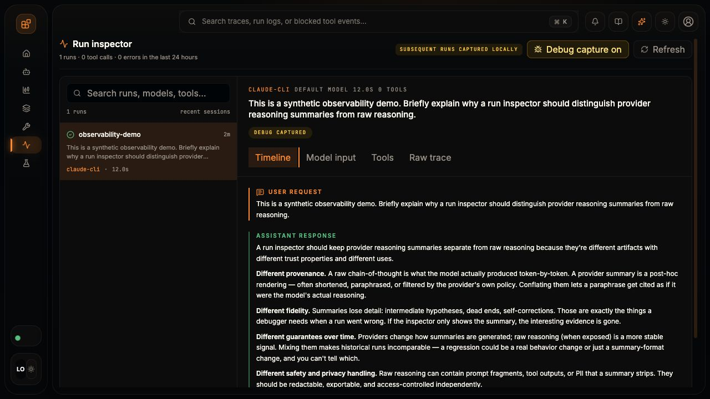
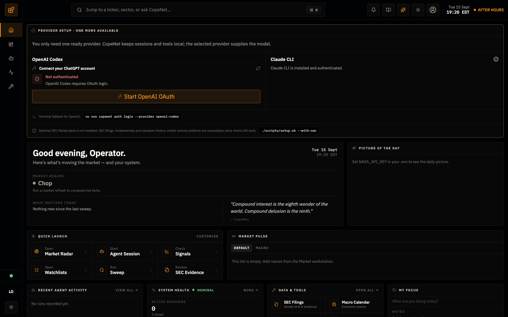

# CopeNet

**Your own stock market terminal, with an AI analyst built in and a ledger that holds its predictions to account.**

CopeNet is a market cockpit you run on your own machine. It covers your portfolio and the whole market: dashboards, charts down to one-minute bars, SEC filings, screeners, alerts and macro. It uses free data sources and has no subscription tier. A full agent harness runs inside it. The AI sees the chart you're looking at, uses real tools, and makes forecasts that get checked against what the market actually did.

You provide the intelligence: an existing Claude or ChatGPT subscription, or an Anthropic API key through Claude Code. There's nothing else to pay for.

## Paywalls you don't hit here

Charting platforms keep adding paywalls: premium tiers for more indicators, fees to share scripts, per-exchange charges for real-time data. CopeNet uses public and free sources, and the whole terminal is yours:

| What | Source | Cost |
|---|---|---|
| Daily history, split-adjusted, cached locally | Yahoo Finance | Free |
| **Intraday bars from 1m to 4h** (1m reaches back 30 days, 5m 60 days, 1h two years) | Yahoo Finance | Free |
| Live quotes on the ticker you're viewing | Yahoo Finance stream | Free |
| 10-K/10-Q financials, 8-Ks, insider trades | SEC EDGAR | Free |
| Screeners across the whole US market | TradingView screener (delayed) | Free |
| Treasury yield curve | US Treasury | Free |
| Macro series | FRED | Free API key |
| Economic calendar | Trading Economics | Free API key |
| Your positions and fills (read-only) | Webull OpenAPI | Free with an account |

Unlimited indicators, unlimited drawings, unlimited alerts and unlimited charts, all running on your hardware. Nobody can take a feature away from you in a pricing change.

## The cockpit

### Market workstation

The Market landing page is a sectioned workstation built around a daily read. The morning brief combines your watchlists, SEC filings and insider activity, sector rotation, accumulation signals and macro context. For each call it also states what would prove it wrong. An unattended sweep refreshes it at 9:45 ET every weekday.



### Ticker workspace

Every symbol opens a chart-first workspace:
- split-adjusted history and intraday intervals
- registry-driven indicators, a TradingView-style drawing toolkit with magnet snapping, and bar replay
- comparisons and formula symbols like `VOO/GLD` or `0.6*VOO + 0.4*TLT`
- your cost basis and fill markers from your own account

The financial explorer plots every SEC-reported line with a link to the filing it came from. Historical P/E uses the EPS that was public *on that date*, not a restated number that leaks the future.



### Screeners, scans and alerts

Screeners find names, scans collect their data, and alerts watch the result. Alerts use the exact indicator math the chart draws. They fire on completed candles and can send a chart image to your phone through Telegram, but only for rules you opted in.

## The AI analyst

### It sees what you see

The chart agent receives a frozen snapshot of the candles, indicators, quote and panels on your screen when you hit send. It reads your drawings as a table and draws levels and zones tied to its evidence. It can research an event on the web. You can open the exact context it saw and confirm it didn't make anything up. Account data stays out unless you opt in.

### It makes predictions and they get checked

This is the part other terminals don't have:

- **The forward ledger.** Every call in the daily brief is logged before the outcome is known and scored later against what happened. You get a running track record, not a feed of confident guesses.
- **Chart forecasts.** Ask a model to forecast a chart. It commits to an entry, stop, targets and thesis, or declines. The setup is frozen and plotted, then tracked against real price as it arrives. You can run two models on the same chart and compare their records.

### It's a real agent, not a chat box

The analyst runs on a full agent harness: persistent sessions, real tools (files, shell, web, market data, memory) and explicit permissions. The same harness drives the **Agents** console, where Claude Code and Codex do general work: coding, research, and transcribing a podcast so you can discuss it.

- **Access is policy, not prose.** Each session runs as **Read-only**, **Ask**, or **Full Access**. Risky commands stop and wait for your approval. The model can't talk its way past the gate.
- **Every action leaves a receipt.** The thread shows each tool call in the order it happened, titled in the model's own words. Each call opens to its full output, arguments and policy decision.
- **The agent remembers what it changed.** A change ledger follows every edit across turns. If you touch a file in between, the agent is told the file changed on disk and must read it again.
- **Fleet rooms** give ChatGPT and Claude the same question. Each answers independently before either sees the other, then they critique each other.



### And you can see how it worked

Observability reconstructs any run from durable records: what the model saw, what it called, its reasoning provenance, and the raw trace. The Usage view shows only tokens the provider reported. Missing data shows as missing, never estimated, and there are no invented dollar figures.



Home ties it together: active sessions, the morning read, your watchlist, system health, and NASA's picture of the day.



The full catalog lives in the **[Feature Glossary](docs/FEATURE-GLOSSARY.md)**.

## What it isn't

- **Not a hosted service.** It runs on your machine. Sessions, market data, traces and your account snapshot stay under `~/.copenet`. Reach it from your phone over your own Tailscale network.
- **Not a trading bot (yet).** It researches, monitors, forecasts and keeps score. The broker connection is read-only, and no code path places an order.
- **Not a local-model runner.** CopeNet started local-only. Small models couldn't hold a multi-step tool workflow together, so it moved to frontier models in September 2026. Your data stays local; the reasoning comes from the frontier.
- **Not a toolkit.** It's one finished app, not a framework for building your own agent pipelines.

## Quickstart

**You need:** Python 3.12+, [`uv`](https://docs.astral.sh/uv/), Node.js 20+, and a Claude or ChatGPT subscription.

```bash
git clone https://github.com/pattty847/CopeNet.git
cd CopeNet
./scripts/setup.sh --with-sec
uv run copenet
```

Open **http://127.0.0.1:17123**. Home walks you through connecting a provider. You only need one:

- **ChatGPT (Codex):** choose **Start OpenAI OAuth** on Home.
- **Claude (Claude Code):** install `claude` and run `claude auth login`. Claude Code also accepts an `ANTHROPIC_API_KEY`.

Charts, quotes and screeners work before you connect anything. `--with-sec` adds SEC filings, fundamentals and insider trades. Leave it off if you only want price data.

### Use it from your phone

CopeNet is laid out for a phone screen and can be installed to your home screen. Serve it over your private Tailscale network:

```bash
# One-time: keep a random token in the gitignored host env file.
umask 077
printf 'COPNET_TOKEN="%s"\nCOPNET_PORT=17123\n' \
  "$(python3 -c 'import secrets; print(secrets.token_urlsafe(32))')" > .copenet.env

# Bind to this Mac's Tailscale address only.
COPNET_HOST=tailscale uv run --env-file .copenet.env copenet
```

Open the tailnet address on another device and enter the token once. Never put the token in a URL.

### Drive it from the terminal

```bash
uv run copenet chat send --session demo --provider openai-codex "What's the regime read this morning?"
```

## Configuration

| Variable | Default | Purpose |
|---|---|---|
| `COPNET_HOST` | `127.0.0.1` | Bind address. `tailscale` binds to this machine's Tailscale IPv4. |
| `COPNET_PORT` | `17123` | HTTP / WebSocket port. |
| `COPNET_TOKEN` | `dev-token` (loopback only) | A private token is required beyond localhost. |
| `COPNET_ALLOWED_ORIGINS` | — | Extra browser origins allowed on `/ws` (comma-separated, with scheme). |
| `COPNET_DATA_DIR` | `~/.copenet/sessions` | Session and transcript storage. |
| `COPNET_MARKET_SENTINEL` | off on loopback | Scheduled market scans. On by default for Tailscale binds. |
| `FRED_API_KEY` | — | FRED macro series. |
| `TRADING_ECONOMICS_API_KEY` | — | Economic calendar in the morning brief. |
| `COPNET_TRACE` | off | `1` starts with Debug capture on (prompt text, tool bodies). Lifecycle traces are always written. |
| `COPNET_WHISPER_MODEL` | `turbo` | MLX Whisper model for transcription. |
| `COPNET_SENTINEL_URL` | `http://127.0.0.1:17100` | Loopback bridge to the Sentinel order-flow app's agent API. |

## Prompts are plain Markdown

Behavior comes from Markdown files you can open and edit:

- **Profiles** (`src/copenet/prompts/presets/profiles/`) set base behavior.
- **Access overlays** (`src/copenet/prompts/presets/task-modes/`) state what the run may do.
- **Personas** (`SOUL.md`, `IDENTITY.md`, `USER.md`) give each runtime an identity you can edit.

Choosing a personality never grants more permissions. Access is a separate setting.

## Docs

| Start here | Architecture | When something's wrong |
|---|---|---|
| [Feature Glossary](docs/FEATURE-GLOSSARY.md) | [Architecture](docs/ARCHITECTURE.md) | [Tracing](docs/TRACING.md) |
| [Startup](docs/STARTUP.md) | [Session Continuity](docs/SESSION-CONTINUITY.md) | [Debugging](docs/DEBUGGING.md) |
| [Testing](docs/TESTING.md) | [Capability Matrix](docs/CAPABILITY-MATRIX.md) | [Runbook](docs/RUNBOOK.md) |
| [Target](docs/TARGET.md) — the north star | [Event Contract](docs/EVENT-CONTRACT.md) — `/ws` protocol | [Threat Model](docs/THREAT_MODEL.md) |
| [Roadmap](docs/plans/ROADMAP.md) | [App API](docs/APP-API.md) — `/api/v1` REST + SSE | |

Contributors and coding agents: read [AGENTS.md](AGENTS.md) first.

## Troubleshooting

**Provider unavailable.** Check the provider panel on Home. It shows whether each provider is missing, signed out or ready. For Claude Code, `claude` must be on your `PATH` and logged in.

**A run did something strange.** Open it in Observability, or read the newest file in `~/.copenet/logs/runs/`. To capture prompt text and tool bodies, turn on **Debug capture** in the Observability header and run it again.

**SEC data missing in Market.** Run `./scripts/setup.sh --with-sec` again. You don't need a separate CopeTech-Edgar checkout.

**Port in use.** `COPNET_PORT=17124 uv run copenet`

---

*CopeNet is kept tidy by the Custodian, the append-only night-shift janitor. His badge says `ACCESS EVERYWHERE`. His patch says `DON'T WRITE. DELETE.` He's why nothing in your transcript gets rewritten.*
